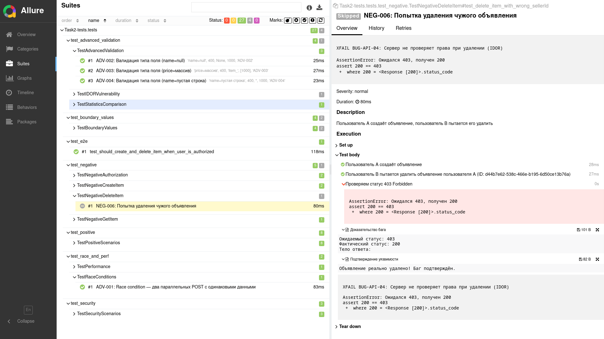

# Тестовое задание QA Trainee — Осень 2026

Автотесты для REST API микросервиса объявлений. Проект включает полный набор тестов: позитивные, негативные, граничные значения, безопасность и продвинутые сценарии.

## Покрытие тест-кейсов

| Категория | ID | Статус | Кол-во |
|-----------|-----|--------|--------|
| E2E | E2E-001 | Реализован | 1 |
| Позитивные | POS-001 — POS-008 | Реализованы | 8 |
| Негативные | NEG-001 — NEG-006 | Реализованы | 6 |
| Граничные значения | BV-001 — BV-006 | Реализованы | 6 |
| Безопасность | SEC-001 — SEC-003 | Реализованы | 3 |
| Продвинутые | ADV-001 — ADV-006 | Реализованы | 6 |
| Производительность | PERF-001 | Реализован | 1 |
| **Итого** | | | **31** |

Полная таблица тест-кейсов: [TESTCASES.md](TESTCASES.md)

## Установка и запуск

### Предварительные требования

- Python 3.10+
- pip

### Шаги

```bash
# 1. Клонировать репозиторий
git clone <url>
cd qa-trainee-assignment-autumn-2026-flow-2-s1sy4-956b0a43-main

# 2. Создать виртуальное окружение
python3 -m venv venv
source venv/bin/activate

# 3. Установить зависимости
pip install -r requirements.txt

# 4. Запустить все тесты
pytest Task2-tests/tests/ -v --alluredir=allure-results

# 5. Сгенерировать Allure-отчёт
allure serve allure-results
```

### Запуск отдельных категорий

```bash
# Только E2E
pytest Task2-tests/tests/test_e2e.py -v

# Только позитивные
pytest Task2-tests/tests/test_positive.py -v

# Только негативные
pytest Task2-tests/tests/test_negative.py -v

# Только граничные значения
pytest Task2-tests/tests/test_boundaries.py -v

# Только безопасность
pytest Task2-tests/tests/test_security.py -v

# Только продвинутые сценарии
pytest Task2-tests/tests/test_advanced.py -v

# С подробным выводом (при отладке)
pytest Task2-tests/tests/ -vvs
```

## Структура проекта

```
.
├── Task1-imgs/                  # Скриншоты багов из задания 1
├── Task2-tests/
│   ├── conftest.py              # Фикстуры (api_client, second_api_client)
│   ── tests/
│       ├── test_e2e.py          # E2E-001: полный цикл
│       ├── test_positive.py     # POS-001...POS-008
│       ├── test_negative.py     # NEG-001...NEG-006
│       ├── test_boundaries.py   # BV-001...BV-006 (параметризация)
│       ├── test_security.py     # SEC-001...SEC-003
│       └── test_advanced.py     # ADV-001...ADV-006, PERF-001
├── images/
│   └── allure-report.png        # Скриншот отчёта
── BUGS.md                      # Найденные дефекты стенда
├── PROMPTS.md                   # История использования ИИ
├── TESTCASES.md                 # Таблица тест-кейсов
├── pyproject.toml               # Конфигурация линтера/форматтера
├── requirements.txt             # Зависимости  
├── README.md
└── TASK1.md                     # Оформленное решение Задания 1
```

## Архитектура тестов

### Фикстуры (conftest.py)

- **`api_client`** — регистрирует пользователя, авторизует, предоставляет `session`, `user_id`, `token` и хелпер `create_item()`. В teardown автоматически удаляет созданные объявления.
- **`second_api_client`** — аналогичная фикстура для второго пользователя (используется в тестах IDOR).

### Принципы

- **Изоляция**: каждый тест начинает с чистого состояния, фикстуры удаляют данные после себя.
- **Уникальность**: все `username` и `name` объявлений генерируются через `uuid.uuid4()`, что исключает конфликты на общем стенде.
- **Читаемость**: имена функций следуют паттерну `test_[действие]_[условие]_[ожидаемый_результат]`.
- **Параметризация**: BV-тесты и часть NEG-тестов используют `@pytest.mark.parametrize` для компактности.
- **Обработка багов стенда**: известные дефекты API помечены через `@pytest.mark.xfail` с указанием ID бага.

## Allure-отчёт

Тесты снабжены подробными шагами через `allure.step`, вложениями (`allure.attach`) для доказательств багов и структурированы по эпику/фиче/стори.



Генерация отчёта:
```bash
pytest Task2-tests/tests/ --alluredir=allure-results
allure serve allure-results
```

## Найденные дефекты

В ходе тестирования выявлено несколько несоответствий поведения стенда ожидаемой бизнес-логике. Подробное описание с шагами воспроизведения и оценкой серьёзности — в файле [BUGS.md](BUGS.md).

Ключевые находки:
- **BUG-API-04** (Critical): IDOR-уязвимость — любой пользователь может удалить чужое объявление
- **BUG-API-01** (High): отсутствие валидации отрицательной цены
- **BUG-API-03** (High): некорректная обработка `0` в полях статистики (falsy-значения)

## Использование ИИ

ИИ применялся как ассистент для генерации шаблонного кода и проверки синтаксиса. Все тест-кейсы, логика проверок, граничные значения и архитектура автотестов контролировались вручную. Подробная история промптов — в файле [PROMPTS.md](PROMPTS.md).

## Линтинг и форматирование

Проект использует **ruff** (линтер + сортировка импортов) и **black** (форматтер).

```bash
# Проверить код
ruff check .
black --check .

# Исправить автоматически
ruff check --fix .
black .
```

Конфигурация: [pyproject.toml](pyproject.toml)

## Соответствие требованиям задания

| Требование | Статус |
|------------|--------|
| Таблица тест-кейсов (POS/NEG/BV/SEC/PERF/ADV) | TESTCASES.md |
| E2E-сценарий (рег → авт → создание → получение → удаление) | test_e2e.py |
| Allure-отчёт со шагами и вложениями | allure.step + allure.attach |
| Пример сформированного отчёта | images/allure-report.png |
| Линтер и форматтер | ruff + black |
| Описание команд запуска | этот файл |
| Найденные баги с обоснованием | BUGS.md |
| История использования ИИ | PROMPTS.md |