# Отчет об ошибках

### 1. Дублируется надпись "Внешний вид"
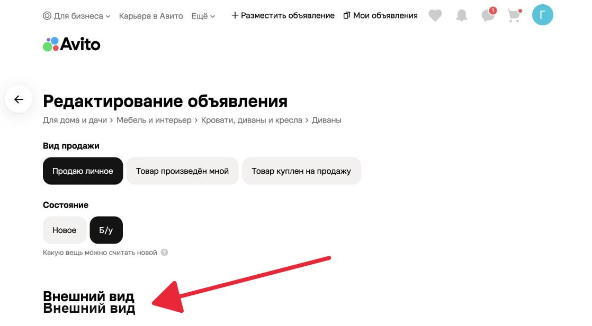  
**Приоритет:P3** 
---

### 2. Синяя рамка не полностью обрамляет фотографию (фото квадратное, рамка закруглённая)
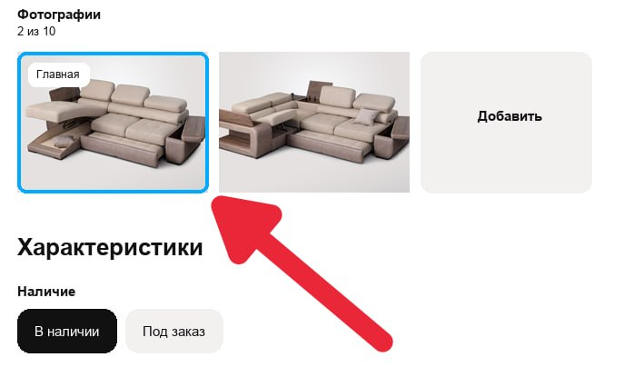  
**Приоритет:P3** 
---

### 3. Нет выбора опции угла
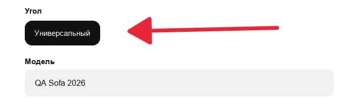  
**Приоритет:P2** 
---

### 4. Выбран 1 способ доставки, при этом отображается 2 способа
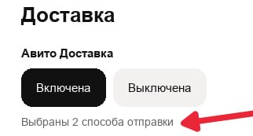  
**Приоритет:P2** 
---

### 5. Отображаются особенности, которые не указаны в форме редактирования
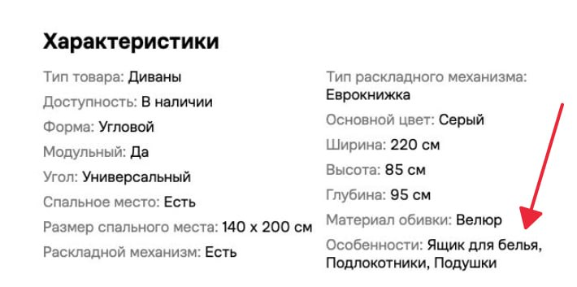  
**Приоритет:P2** 
---

### 6. Отсутствие хлебных крошек в карточке продавца
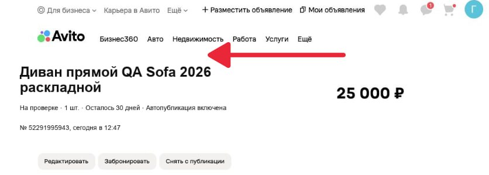  
**Приоритет:P2** 
---

### 7. Цифра 6 отображается некорректно поверх основного графика
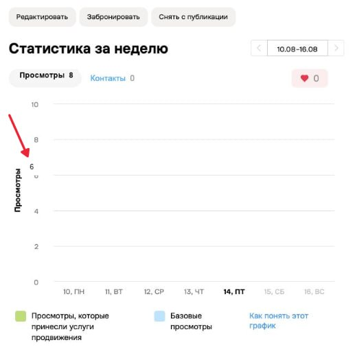  
**Приоритет:P3** 
---

### 8. В графе "Просмотры" отображается 8, но на графике они не отображаются
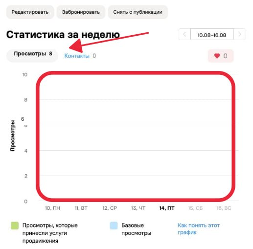  
**Приоритет:P2** 
---

### 9. Значок стрелки перехода обрезан или перекрыт с левой стороны
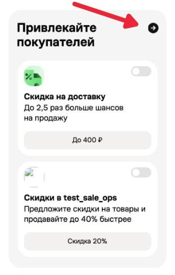  
**Приоритет:P3** 
---

### 10. Не подгружается изображение в предложении "Привлечение покупателей", блок "Скидки в ..."
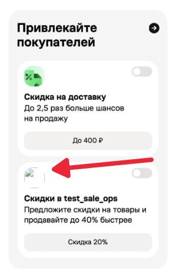  
**Приоритет:P2** 
---

### 11. Некорректно отображается переменная в выражении "Скидки в ..."
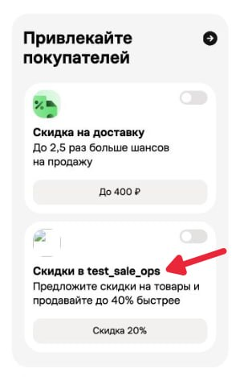  
**Приоритет:P2** 
---

### 12. При выборе 1 способа доставки отображается "Выбраны 2 способа отправки"
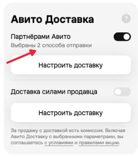  
**Приоритет:P2** 
---

### 13. В нижней части карточки продавца дублируется шапка верхней части страницы
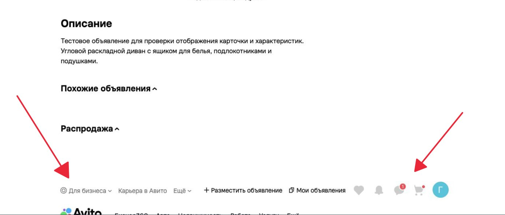  
**Приоритет:P2** 
---

### 14. В карточке продавца не отображаются объявления в разделе "Похожие объявления" и "Распродажа" 
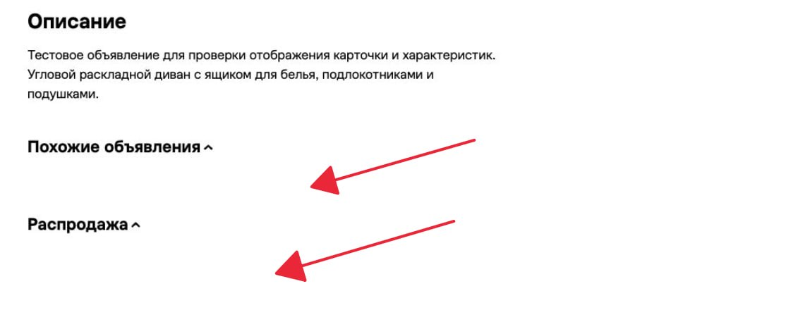  
**Приоритет:P2**  
---

### 15. В карточке товара тображается "Доставка недоступна" при включенной доставке в карточке продавца
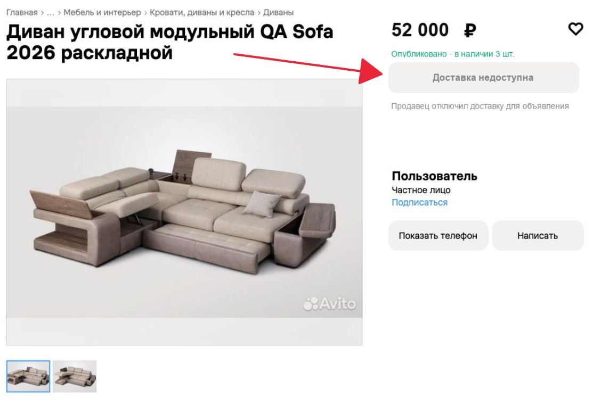
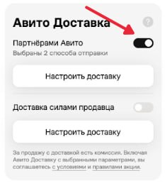  
**Приоритет:P0** 
---

### 16. В карточке товара надпись "Описание" подрезана или перекрыта сверху
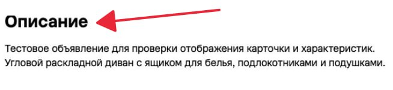  
**Приоритет:P3** 
---

### 17. В карточке товара в блоке "Найти своё в ресейле" не подгружается картинка к надписи "Ресейл" в правом нижнем углу
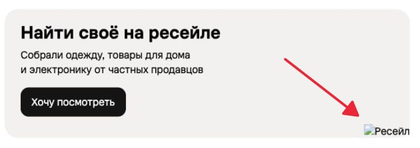  
**Приоритет:P3** 
---

### 18. Главная фотография товара в карточке товара отличается от выбранной в карточке продавца
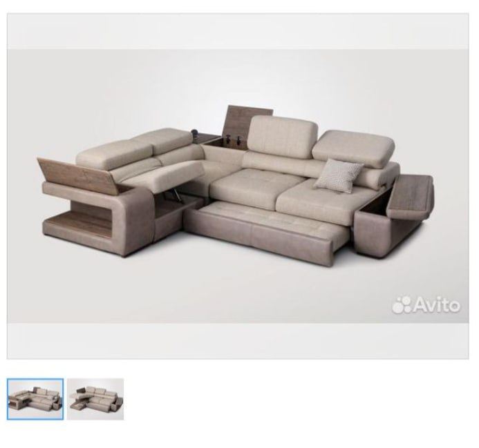
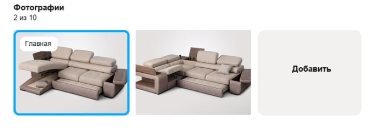  
**Приоритет:P1** 
---

### 19. Отличается цена товара в карточке товара и продавца
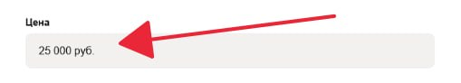
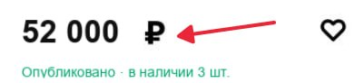  
**Приоритет:P0** 
---

### 20. Отличается количество товара в карточке товара и продавца
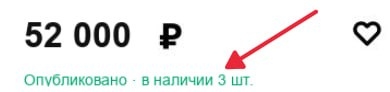
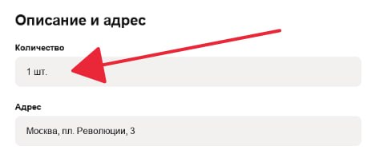  
**Приоритет:P1** 
--

### 21. Отличаются детали о товаре и хар-ки в карточке товара и продавца
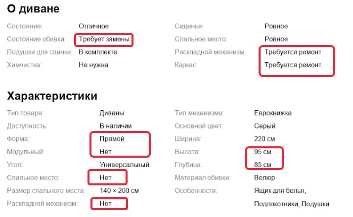  
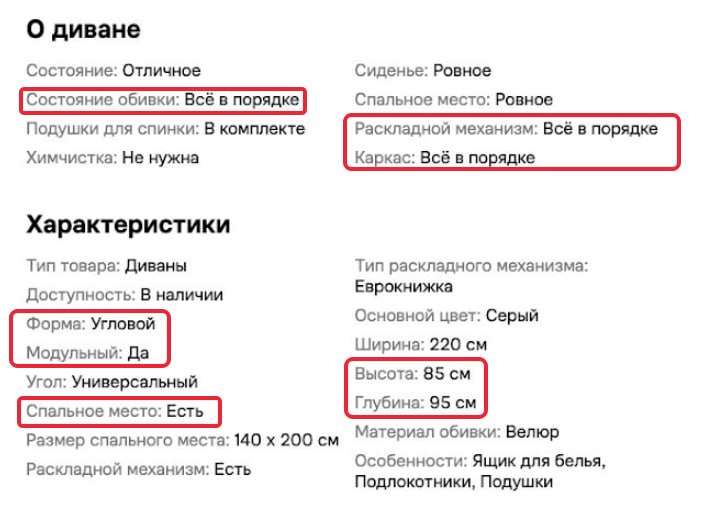  
**Приоритет:P1**
---

### 22. Имя продавца в карточке товара и продавца отличаются
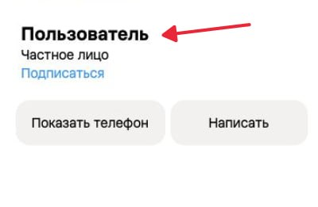  
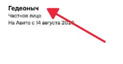  
**Приоритет:P1** 
---
### 23. На странице карточки товара дублируется верхняя шапка после нижней
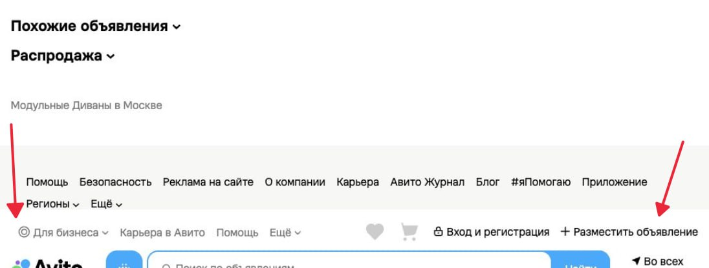  
**Приоритет:P2** 